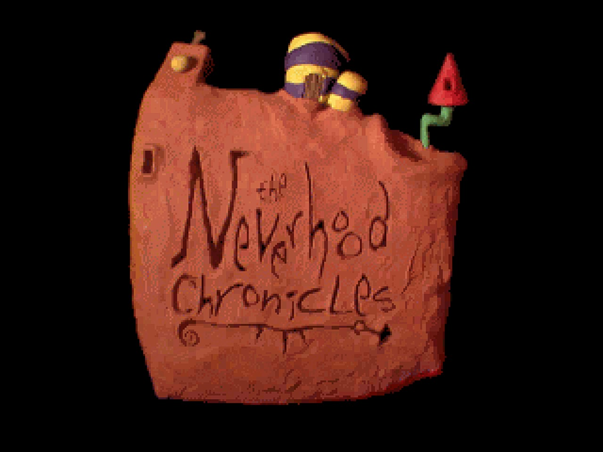
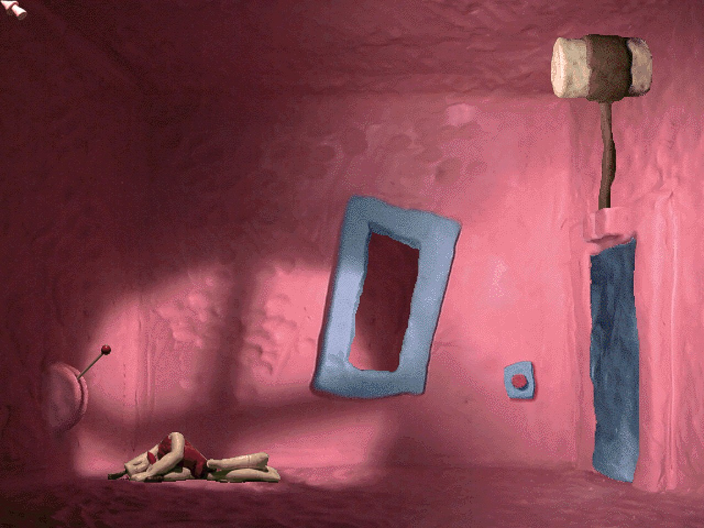
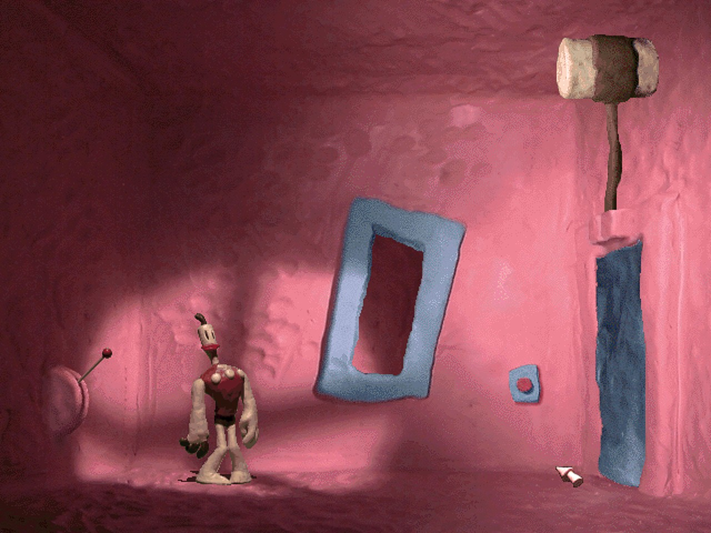
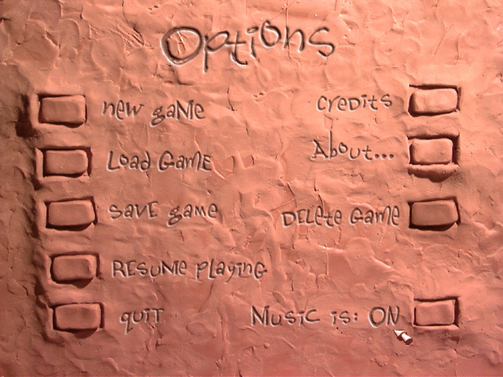

# The Neverhood - PC Native

The 1996 claymation adventure **The Neverhood**, running natively on modern Windows.

The game's own code - `nhc.exe` and the Smacker video library `smackw32.dll` it ships with -
is recompiled from x86 machine code to C and runs on a new PC runtime that replaces
Windows 95, DirectDraw, DirectSound and the registry. No compatibility mode, no DirectDraw
emulation layer, no CD-ROM or save-game patches, no registry entries, no disc to mount.



| | |
|---|---|
|  |  |
|  | |

*Screenshots at 1280 x 960 with the default bicubic upscale.*

## Install

You need your own copy of The Neverhood (the English Windows CD, or an ISO / BIN+CUE image of
it, or a copied folder). This repository contains no game files.

1. Download **The Neverhood PC Setup.exe** from the [Releases](../../releases) page.
2. Run it, choose your CD (drive, image or folder) and an install folder.
3. Start the game from the Start menu or desktop shortcut.

Setup copies the disc to the install folder (about 620 MB), so the CD is never needed again,
and gives the game exe the icon from your CD. Uninstall from Windows' *Apps* list.

Silent install: `"The Neverhood PC Setup.exe" /silent /cd <iso|cue|drive|folder> /dir <folder> [/nodesktop] [/nostartmenu]`

## Playing

- Mouse: point and click. **Esc** skips a movie, and in the game opens the Options menu
  (new game, save, load, quit).
- The game starts fullscreen; **Alt+Enter** switches between fullscreen and a window.
- In window mode the menu bar has the options:
  - **Video** - Resolution (upscale to 1x-4x of 640 x 480 or straight to the window),
    Aspect Ratio (4:3, stretch, integer), Upscale Filter (bicubic, nearest, bilinear,
    sharp bilinear, xBR), FXAA, Sharpening.
  - **View** - window size, fullscreen, FPS in the title bar.
- Settings are kept in `neverhood.ini`; saved games in `neverhood_registry.txt`, both next to
  `neverhood.exe` (the original game kept its saves in the Windows registry).
- The game pauses when its window loses focus, like the original.

All of the game's pictures and movies are 640 x 480. The Resolution option sets how large
the upscale filter makes them before they are fitted to the screen; it cannot add detail
the original art does not have.

## How it works

| Part | What |
|---|---|
| `tools/pe.py`, `tools/x86an.py`, `tools/recomp.py` | PE loader, control-flow analysis, x86 -> C static recompiler (from our DOS ports' kit, extended for Win32 programs) |
| `src/gen/` | the generated C code of `nhc.exe` (7,900 functions) and `smackw32.dll` (530) - made at build time, not in the repo |
| `src/rt/main.c` | guest address space, function dispatch, calls from native code into game code |
| `src/rt/pe.c` | maps the original images (data, resources) from the installed game, binds imports |
| `src/rt/win32.c` | KERNEL32 / USER32 / GDI32 / WINMM functions the game uses, natively |
| `src/rt/window.c` | the window, the game's message queue, mouse and keyboard |
| `src/rt/ddraw.c` | DirectDraw: surfaces, flip chain, palette, colour-keyed blits |
| `src/rt/dsound.c` | DirectSound: sound buffers mixed through SDL audio |
| `src/rt/registry.c` | the registry the game reads and saves to, as a text file |
| `src/rt/present.c` | Direct3D 9 output: palette -> RGB, upscale filters, sharpening, menu bar |
| `installer/` | setup / uninstall: reads the CD from a drive, ISO, BIN+CUE or folder |

The game's only extra thread (a resource pre-loader whose result the main loop polls) runs to
completion when it is started; Smacker's timer callbacks run on the game's thread.

## Building

Needs Windows Python 3 with `capstone`, MSYS2 MINGW64 (gcc, SDL2), and the
game's `nhc.exe` and `smackw32.dll` (from the CD's `SETUP` folder) in `gamedata/`.
Ghidra (optional) refreshes `re/*/functions.tsv`.

```bash
make gen          # recompile nhc.exe and smackw32.dll to src/gen/
./build.sh        # build Neverhood.exe
make release      # The Neverhood PC Setup.exe (the game exe inside)
```

For a dev run put the installed game files in `game/hd` (nhc.exe, smackw32.dll, HD.BLB) and
the CD in `game/cd`, then run `PLAY.bat`. `./run_test.sh <seconds>` runs it hidden and muted;
test switches: `NH_SHOT=ms;ms`, `NH_SHOTOUT=1`, `NH_KEYS=ms:vk;...`, `NH_CLICK=x,y,ms;...`,
`NH_WINSIZE=WxH`, `NH_TRACEAPI=1`.

## Legal

A fan project. The Neverhood is (c) 1996 The Neverhood, Inc. and DreamWorks Interactive;
Smacker is (c) RAD Game Tools. No game data or original code is included here - the installer
uses your own copy of the game.
